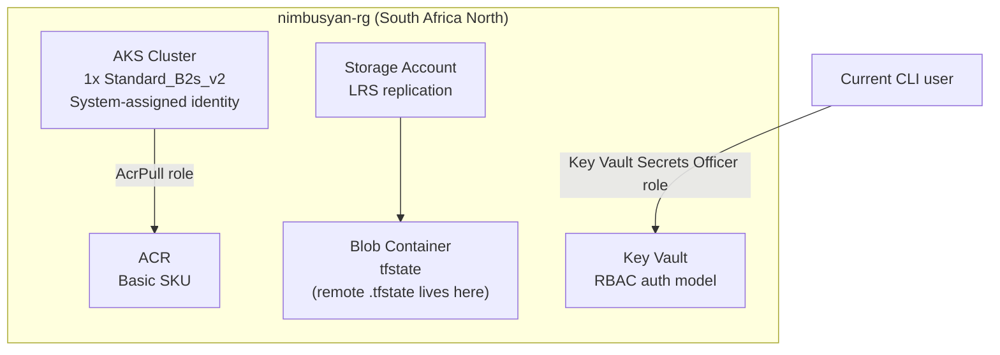

# nimbus-module3-terraform — Full IaC Stack on Azure

> Nimbus Compute Academy — Module 3 (complete) · October 2026

A full Infrastructure-as-Code stack on Azure built end-to-end with Terraform: Resource Group → AKS → ACR → Key Vault → Storage Account + Blob Container → RBAC role assignments → remote state. Started with a single Resource Group in Lesson 1, grew lesson-by-lesson across 11 lessons into a working multi-service stack with remote state in Azure Blob.

The repo is deliberately verbose on **what broke and how I fixed it**. Nine production-style postmortems document the real debugging path — PATH caching on Windows, Entra Security Defaults, variable-reference limits, provider registration walls, SKU restrictions, and an architectural contradiction in the mentor's reference code that only surfaced at smoke-test time.

---

## 🎯 What this project proves

- **Terraform fundamentals**: HCL syntax, provider pinning, variables, locals, outputs, data sources, resource composition, idempotent `init → plan → apply` cycles
- **State discipline**: `.tfstate` understood as secret; `.gitignore` configured before first commit; lock file committed, state file never; **remote state migrated to Azure Blob** so laptop crashes don't kill the stack
- **Azure platform fluency**: Resource Groups, AKS, ACR, Key Vault, Storage Accounts, Blob Containers, RBAC role assignments, Resource Provider registration, VM SKU restrictions in regional subscriptions
- **Error-driven debugging**: deployed the mentor's reference code deliberately to meet the errors first-hand, then fixed them one error family at a time — the way Lesson 10 teaches
- **Smoke-test discipline**: `terraform apply` reporting success is not the same as resources being operationally functional. One real `az`/`kubectl` command per deployed service caught a Key Vault auth-model bug that would have shipped silently otherwise

---

## 🏗️ Architecture at a glance



**8 Terraform-managed resources** plus 1 `data.azurerm_client_config.current` lookup. Everything lives in a single Resource Group except what Azure auto-manages for AKS (nodes live in a hidden `MC_nimbusyan-rg_nimbusyan-aks_...` RG that Azure owns).

---

## 📁 Repository shape

```
nimbus-module3-terraform/
├── README.md                      ← you are here
├── ERRORS.md                      ← raw error log kept during the module
├── .gitignore                     ← excludes .tfstate*, .terraform/, *.tfvars
└── terraform-rg-project/          ← folder named after Lesson 1's single-RG scope; grew in place
    ├── providers.tf               ← azurerm provider pinned to ~> 5.0
    ├── main.tf                    ← Resource Group
    ├── aks.tf                     ← Kubernetes cluster + system-assigned identity
    ├── acr.tf                     ← Container Registry
    ├── keyvault.tf                ← Key Vault (RBAC auth mode)
    ├── storage.tf                 ← Storage Account + tfstate blob container
    ├── rbac.tf                    ← AcrPull + Key Vault Secrets Officer role assignments
    ├── data.tf                    ← data.azurerm_client_config for tenant/object IDs
    ├── variables.tf               ← tunable inputs (project_name, VM size, SKUs, tags)
    ├── locals.tf                  ← computed names: ${project_name}-aks, etc.
    ├── outputs.tf                 ← 9 outputs incl. kube_config (sensitive)
    ├── backend.tf                 ← remote state config (Azure Blob)
    └── .terraform.lock.hcl        ← provider version lock (committed)
```

The folder keeps its lesson-1 name as a historical fingerprint. If you fork this and start fresh, feel free to rename it to `stack/` or `terraform/`.

---

## 🔧 Prerequisites

| Component | Version used |
|---|---|
| Terraform | v1.16.5 |
| azurerm provider | v5.0.0 |
| Azure CLI | installed via winget |
| Shell | Git Bash on Windows 11 |
| Target region | South Africa North |

**Subscription setup** (one-time per subscription):
```bash
# Register the Resource Providers used by this stack
az provider register --namespace Microsoft.ContainerRegistry
az provider register --namespace Microsoft.ContainerService
az provider register --namespace Microsoft.KeyVault
az provider register --namespace Microsoft.Storage
az provider register --namespace Microsoft.Authorization
az provider register --namespace Microsoft.Compute
az provider register --namespace Microsoft.Network

# Verify all show Registered before applying
az provider list --query "[?namespace=='Microsoft.ContainerRegistry' || namespace=='Microsoft.ContainerService'].{Namespace:namespace, State:registrationState}" -o table
```

See [Postmortem #7](#postmortem-7--the-subscription-cold-start-wall) for why.

---

## 🚀 How to run it

```bash
# 1. Authenticate (device-code is more reliable than browser callback)
az login --use-device-code

# 2. Enter the Terraform folder
cd terraform-rg-project

# 3. First-time init — with backend.tf COMMENTED OUT (local state)
terraform init
terraform plan     # expect: 8 to add
terraform apply    # type 'yes'; takes ~5-10 min (AKS is the slow one)

# 4. Smoke-test — proves resources are not just deployed but functional
az acr login --name <acr_name>                                    # expect: Login Succeeded (needs Docker Desktop)
az aks get-credentials --resource-group <rg_name> --name <aks_name>
kubectl get nodes                                                 # expect: 1 node Ready
az keyvault secret set --vault-name <kv_name> --name hello --value world  # expect: JSON output
az storage container list --account-name <storage_name> --auth-mode login # expect: "tfstate"

# 5. Migrate state to Azure Blob (optional but recommended)
# Uncomment backend.tf, then:
terraform init -migrate-state     # type 'yes' when prompted — moves .tfstate into the blob

# 6. ALWAYS clean up
terraform destroy
```

Expected final apply line:
```
Apply complete! Resources: 8 added, 0 changed, 0 destroyed.
```

---

## 📋 The 11 lessons condensed

| # | Lesson | What it adds | Key file |
|---|---|---|---|
| 1–3 | IaC intro + first Resource Group | provider + first `terraform apply` | `providers.tf`, `main.tf` |
| 4 | AKS + ACR | Kubernetes cluster + container registry | `aks.tf`, `acr.tf` |
| 5 | Key Vault + Storage + Blob | Secret store + object storage + container | `keyvault.tf`, `storage.tf`, `data.tf` |
| 6 | Remote state backend | Azure Blob backend declared (migrate in L11) | `backend.tf` |
| 7 | RBAC role assignments | AcrPull (AKS→ACR), KV Secrets Officer | `rbac.tf` |
| 8 | Variables refactor | Parameterize every hardcoded value | `variables.tf` |
| 9 | Outputs | Expose `aks_cluster_name`, `acr_login_server`, `kube_config_raw`, etc. | `outputs.tf` |
| 10 | Troubleshooting + locals | `terraform validate` loop; introduce `locals.tf` for composed names | `locals.tf` |
| 11 | Final apply + state migration | Full `terraform apply`; `terraform init -migrate-state` moves state to Blob | — |

---

## 🔥 Postmortems

Production-style write-ups for the significant errors I hit across Module 3. Grouped: **setup** (before the first `terraform apply`) and **in-flight** (during lessons 4–11).

### Setup saga — before Terraform could run

### Postmortem #1 — Terraform installed but Git Bash can't see it

**Severity**: 🟢 Low · **Status**: ✅ Resolved · **Time lost**: ~20 min

**What happened**: After `winget install Hashicorp.Terraform` in PowerShell, `terraform version` worked in PowerShell but Git Bash returned `bash: terraform: command not found`. Added what I thought was the right path to `~/.bashrc` — still broken. Added it to the VS Code integrated terminal — still broken.

**Root cause**: Two issues stacked.
1. Git Bash caches `$PATH` at launch — a new install isn't visible until the shell fully restarts.
2. My first guess at the winget install directory was wrong. The real path is `/c/Users/PC/AppData/Local/Microsoft/WinGet/Links`, not the Chocolatey-style path I'd assumed.

**Resolution**:
```bash
echo 'export PATH="$PATH:/c/Users/PC/AppData/Local/Microsoft/WinGet/Links"' >> ~/.bashrc
# close Git Bash entirely, reopen
terraform version
```

**Lessons learned**:
- After editing `~/.bashrc`, close the terminal fully — `source ~/.bashrc` reloads only the current shell, new processes inherit the parent's old environment.
- For VS Code integrated terminals, close VS Code itself, not just the terminal tab. The terminal inherits the editor's environment, set once at launch.
- Confirm an install location with `where <command>` in PowerShell before guessing a path.

---

### Postmortem #2 — Azure CLI silently absent

**Severity**: 🟢 Low · **Status**: ✅ Resolved

**What happened**: Assumed `az` would be available after installing Terraform. It wasn't. `az login` returned `bash: az: command not found`.

**Root cause**: Azure CLI is a completely separate tool from Terraform. Terraform calls Azure's REST API, but authentication is delegated to whatever credentials `az login` has cached. No `az` = no auth = no deploy.

**Resolution**:
```powershell
winget install -e --id Microsoft.AzureCLI
```
Then restart the shell.

**Lessons learned**: Terraform provider documentation always lists its auth prerequisites. Read them BEFORE the first `terraform init`, not after it fails. For `azurerm`, acceptable auth is: Azure CLI, Service Principal, or Managed Identity.

---

### Postmortem #3 — `az login` hung indefinitely on browser callback

**Severity**: 🟡 Medium (silent hang — no error message) · **Status**: ✅ Resolved + default behavior changed

**What happened**: `az login` opened a browser, I signed in successfully, the browser displayed *"Vous vous êtes connecté"* — and then the terminal hung. Ten minutes. No error, no output, just a blinking cursor.

**Root cause**: The browser-based OAuth callback flow depends on a local server that `az` spins up to catch the redirect from Microsoft. On some Windows network configurations (firewalls, antivirus, VPNs, port conflicts) that redirect never lands, and `az` has no timeout — it waits forever.

**Resolution**:
```bash
az login --use-device-code
```
Device-code flow doesn't need a callback — you type a code into a browser URL yourself. Takes 30 seconds and always works.

**Lessons learned**: For any CLI auth flow, prefer device-code when it's offered. Slightly less convenient but zero dependency on local networking. `--use-device-code` is now my default for every `az login`.

---

### Postmortem #4 — Microsoft defaulted to passkey, passkey failed

**Severity**: 🟢 Low · **Status**: ✅ Resolved

**What happened**: During `az login`, the Microsoft sign-in page defaulted to passkey authentication. My device had no passkey registered. Got the French error: *"Nous n'avons pas pu vous connecter — Un problème s'est produit lors de la tentative de connexion avec une clé d'accès."*

**Root cause**: Modern Microsoft login tries passwordless methods first. If none are configured, it still shows the passkey prompt before offering fallback options.

**Resolution**: Click **"Connectez-vous autrement"** → choose password.

**Lessons learned**: The "sign in differently" link is always available, usually in small type below the main button. Don't retry the failing method — look for the alternative.

---

### Postmortem #5 — AADSTS530035: Security Defaults blocked the CLI

**Severity**: 🟠 High (blocked the entire deployment) · **Status**: ✅ Resolved

**What happened**: After solving everything above, `az login` finally succeeded. Then:
```
AADSTS530035: Application 'Microsoft Azure CLI' is blocked by your
organization's conditional access policy.
No subscriptions found for tazoh_yanick@outlook.com.
Device state: Unregistered
```

Tried everything:
- Normal `az login` → blocked
- `az login --tenant <tenant-id>` → blocked
- `az login --tenant <tenant-id> --use-device-code` → still blocked

Classic chicken-and-egg: couldn't deploy because I couldn't authenticate; couldn't fix the auth policy from the CLI because the only way in was through the Portal.

**Root cause**: Microsoft Entra ID **Security Defaults** were enabled on my personal tenant. Security Defaults enforce "require MFA + registered device" for admin tools like Azure CLI. My laptop wasn't registered in Entra, so even correct MFA couldn't unblock the login.

**Resolution**: Portal → Microsoft Entra ID → Properties → **Manage security defaults** → **Disabled**. Then `az login --use-device-code` worked and the subscription appeared.

**Trade-off accepted**: My personal tenant has one user (me). Disabling Security Defaults loses the "always require MFA" guarantee, but gains CLI access from any device. For a learning tenant this is acceptable. For a production tenant with multiple users or sensitive workloads I would NOT disable Security Defaults — I'd register the device first (Windows Settings → Accounts → Access work or school → Connect).

**Lessons learned**:
- Entra Security Defaults are ON by default for all tenants created after October 2019. If you've never touched the setting, you have them.
- `AADSTS530035` + `Device state: Unregistered` is the specific fingerprint of this problem. Don't retry auth — go to the policy.
- Always classify a login failure as credential-level or policy-level. The error code (`AADSTS###`) tells you which.

---

### In-flight debugging — during lessons 4–11

### Postmortem #6 — "Variables not allowed" — the parse-order rule

**Severity**: 🟡 Medium (blocked `terraform init`) · **Status**: ✅ Resolved

**What happened**: Mid-refactor to variables, I tried to compose resource names right inside the `variables.tf` defaults:
```hcl
variable "acr_name" {
  default = "${var.project_name}acr"   # ← looked clean, broke everything
}
```
Four variables did this. `terraform init` returned four identical errors:
```
Error: Variables not allowed
A variable may not be used here.
```

**Root cause**: Terraform parses all `variable` blocks in parallel at the start of a run. There is no dependency graph between them — `acr_name` cannot "wait for" `project_name` to resolve first. Defaults must be **literal expressions**; they can't reference other variables, locals, or resources.

**Resolution**: Deleted the four problematic variables entirely. Moved the composition to the resource files, where `var.X` references ARE allowed. Later moved them again to `locals.tf` for DRY:
```hcl
# locals.tf
locals {
  acr_name = "${var.project_name}acr"
}

# acr.tf
resource "azurerm_container_registry" "acr" {
  name = local.acr_name
  ...
}
```

**Lessons learned**:
- `variables.tf` is for RAW inputs (user-tunable values). `locals.tf` is for DERIVED values (computed from vars, other locals, or resource attributes).
- The error family "**Variables not allowed**" appears any place Terraform parses before variables resolve: variable defaults, backend blocks, provider version strings. If you need composition in those places, you can't have it — hardcode or move the logic elsewhere.

---

### Postmortem #7 — Backend chicken-and-egg

**Severity**: 🟡 Medium · **Status**: ✅ Resolved via sequencing

**What happened**: I wrote `backend.tf` pointing at the storage account the stack would eventually create. On `terraform init`, Terraform's first job is reading the backend config and connecting to the storage account to validate state access. The account didn't exist yet:
```
Error: retrieving Storage Account ... "nimbusstorageacct" ... was not found.
```

**Root cause**: Backend init happens **before** anything else. It cannot create the backend's storage account itself (chicken-and-egg: it needs the state to be writable before it can create resources, but the resource it needs is the state storage).

**Resolution** — two-step deployment:
1. Keep `backend.tf` commented out
2. `terraform apply` with local state — this creates the storage account + container among other resources
3. Uncomment `backend.tf`
4. `terraform init -migrate-state` — moves the local `terraform.tfstate` into the Azure blob

**Lessons learned**:
- Terraform backend blocks are evaluated at init time, not plan/apply time. They cannot reference variables, locals, or resource outputs — all values must be hardcoded literal strings.
- The backend bootstrap problem has one answer: deploy the state storage with local state first, then migrate. If you want the backend fully managed by Terraform, this is unavoidable.

---

### Postmortem #8 — The subscription cold-start wall

**Severity**: 🟠 High (blocked ACR, AKS, and the AKS vm_size I'd chosen) · **Status**: ✅ Resolved on third `apply`

**What happened**: With everything validated and `terraform apply` running clean against RG, KV, Storage, and Role Assignments, two resources threw:
```
Error: 409 MissingSubscriptionRegistration: The subscription is not
registered to use namespace 'Microsoft.ContainerRegistry'.
Error: 409 MissingSubscriptionRegistration: ... 'Microsoft.ContainerService'.
```
Fixed those via `az provider register`, retried. Then AKS threw a new error:
```
Error: 400 BadRequest: The VM size of Standard_D2s_v3 is not allowed
in your subscription in location 'southafricanorth'.
```
The error listed hundreds of allowed SKUs. The mentor's reference code used `Standard_D2s_v3` which worked on their subscription but not mine.

**Root cause**: Two separate Azure gotchas with the same deeper cause — **subscriptions are not uniform**:
1. **Resource Provider registration**: each service namespace (`Microsoft.ContainerRegistry`, etc.) must be *registered* on the subscription before resources of that type can be created. Many RPs auto-register via Portal usage, but a cold subscription that's never deployed AKS/ACR has them in `NotRegistered` state.
2. **VM SKU restrictions**: subscription + region combinations have individual SKU allowlists. Pay-as-you-go/free-tier subs in SA North don't get `D2s_v3`. B-series (burstable, cheap, universally available) is the lab-safe default.

**Resolution**:
```bash
# RP registration — one time per subscription
az provider register --namespace Microsoft.ContainerRegistry
az provider register --namespace Microsoft.ContainerService
# wait 1-5 min for both to show Registered

# Switch VM SKU in variables.tf
default = "Standard_B2s_v2"   # 2 vCPU, 8 GB RAM, burstable, allowed everywhere
```

**Lessons learned**:
- When starting Terraform on any new Azure subscription, **pre-register every RP you plan to deploy** before the first `apply`. Saves fail-wait-retry cycles later.
- When a tutorial's VM SKU fails on your subscription, read the error — Azure lists every allowed alternative in the error message. **Pick a B-series for labs** (`B2s_v2` is my new default): burstable billing, cheap at idle, broadly available.
- The mentor's code worked on their subscription. Infrastructure code is not fully portable across subscriptions; expect to tune SKU-level decisions per-tenant.

---

### Postmortem #9 — Key Vault auth-model contradiction

**Severity**: 🟠 High (would have shipped silently) · **Status**: ✅ Resolved via smoke test

**What happened**: `terraform apply` completed. All 8 resources deployed. All outputs returned real values. The smoke test on three services passed. Then:
```bash
$ az keyvault secret set --vault-name nimbusyan-kv --name hello --value world
(Forbidden) The user, group or application ... does not have secrets
set permission on key vault 'nimbusyan-kv'.
```

The vault was deployed but **operationally unusable**.

**Root cause**: The mentor's reference code contradicted itself across two files, and I deployed the contradiction verbatim:
- `keyvault.tf` set `rbac_authorization_enabled = false` → access-policy auth model
- The `access_policy { }` block declared my `object_id` but **no permissions** (`secret_permissions`, `key_permissions`, etc.)
- `rbac.tf` added `azurerm_role_assignment "kv_secrets_officer"` with role `"Key Vault Secrets Officer"` — an RBAC role that only works when `rbac_authorization_enabled = true`

So the vault had an access-policy entry granting zero permissions AND a role assignment that didn't apply. Net access: none. **The bug deploys green** — only a real `secret set` or `secret list` surfaces it.

**Resolution**: Flipped the vault to the modern RBAC auth model:
```hcl
# keyvault.tf
resource "azurerm_key_vault" "kv" {
  # ... existing fields ...
  rbac_authorization_enabled = true   # ← was false
  # access_policy block deleted entirely
}
```
Re-ran `terraform apply` — one resource changed in place (no destroy). Re-ran the smoke test — succeeded. The pre-existing `azurerm_role_assignment.kv_secrets_officer` now grants real permissions.

**Lessons learned**:
- `terraform apply` success means Azure accepted every API call, **not** that the resulting system is functional. Always smoke-test with one real operation per service after apply.
- The access-policy and RBAC auth models in Azure Key Vault are **mutually exclusive**. Pick one and keep every related resource (access_policy blocks, role_assignments) consistent with that choice.
- Tutorial code from vendor videos sometimes contains silent architectural bugs. Reading error messages at use-time is a critical catch; reading tutorial code critically at write-time is better.
- RBAC is the modern Azure best practice. Access policies still work but are being deprecated across Azure services.

---

## 🧠 Overall lessons learned

1. **The deploy is 10% of the work.** Setup, auth, cross-platform shell issues, subscription-level policy, SKU restrictions, and architectural bugs are the other 90%. Budget time accordingly.

2. **Error-driven learning beats tutorial-follow learning.** Deploying known-imperfect code deliberately and fixing errors as they surface teaches you how to read Terraform output. Shortcut this and you learn only the happy path.

3. **Smoke-test everything with one real operation.** `terraform apply` success ≠ functional stack. One `az`/`kubectl` command per service catches architectural bugs that validate and plan don't see.

4. **State files are secrets, backend bootstraps are chicken-and-egg.** Never commit `.tfstate`; commit the lock file. Deploy the state storage with local state first, migrate to the backend second.

5. **`variables.tf` holds inputs. `locals.tf` holds derived values.** The parse-order rule means you cannot compose in a variable's default. Move composition to resource files or (DRY) to a `locals.tf`.

6. **Pre-register Azure Resource Providers on any new subscription.** `az provider register` for every RP you plan to deploy saves failed `apply` runs mid-lesson.

7. **Pick B-series VMs for labs.** Burstable, broadly available, cheap at idle. `D`-series is for predictable production workloads, not Hello World on AKS.

8. **Commit the lock file, not the state file.** `.terraform.lock.hcl` pins provider versions and makes `terraform init` reproducible across machines.

9. **`terraform destroy` after every session.** AKS alone costs ~$70/month if left running.

---

## 💰 Costs & cleanup

Approximate monthly cost if left running:
| Resource | ~Cost |
|---|---|
| AKS node (1x Standard_B2s_v2 burstable) | ~$35/mo |
| ACR Basic | ~$5/mo |
| Key Vault | pennies (per-op pricing) |
| Storage Account (LRS) + Blob | pennies |
| **Total** | **~$40/mo** at full use, less when idle |

The AKS node is the main cost. **Always `terraform destroy` after a session.** Rebuilding takes ~10 minutes.

---

## 👤 About

Built by **Tazoh Yanick Tazoh** ([@t-yanick](https://github.com/t-yanick)) — DevOps Engineer at Nimbus Compute (UK), pivoting from Computer Science teaching in Yaoundé, Cameroon into cloud and platform engineering.

**Related work**:
- [nimbus-azure-capstone](https://github.com/t-yanick/nimbus-azure-capstone) — Module 1: two-region zero-trust Azure topology (hub-and-spoke, Private Endpoints, Bastion, Managed Identity)
- [nimbus-linux-essentials](https://github.com/t-yanick/nimbus-linux-essentials) — Module 2: 20 Git Bash hands-on challenges with 4 production-style postmortems

**Connect**: [LinkedIn](https://www.linkedin.com/in/tazoh-yanick-tazoh/) · tyankee15@gmail.com

🇨🇲 → 🇨🇦

---

## 📄 License

MIT
